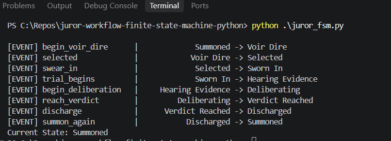

# Juror Workflow Finite State Machine

A small Python example that models a juror moving through a simplified trial workflow. It demonstrates how a finite-state machine (FSM) can keep track of an object's current state and allow only explicitly defined transitions.

## What the App Does

The app creates a juror in the `Summoned` state, processes a sequence of events, and prints each event and state transition. The demo moves the juror through the trial workflow, discharges them, then summons them again.

The states are:

1. `Summoned`
2. `Voir Dire`
3. `Selected`
4. `Sworn In`
5. `Hearing Evidence`
6. `Deliberating`
7. `Verdict Reached`
8. `Discharged`

A juror can be summoned again after being discharged, returning the model to `Summoned`.

## What Is an FSM?

A finite-state machine is a model with a finite set of states and rules for moving between them. It has a current state and receives events. The combination of the current state and an event determines whether a transition is allowed and, if so, which state comes next.

In this app, `JurorState` defines the states, and `JurorFSM.TRANSITIONS` lists the allowed `(current state, event) -> next state` rules. For example, `begin_voir_dire` moves a juror from `Summoned` to `Voir Dire`.

If an event is not valid for the current state, `process_event()` raises `ValueError`. It checks that the transition exists before changing the current state, so an invalid event leaves the state unchanged.

## FSM vs. Turing Machine

A Turing machine is a more powerful theoretical model of computation. Like an FSM, it has a finite set of control states and rules that determine what happens next. The key difference is that a Turing machine also has a tape that it can read from and write to, plus a head that moves along the tape. The tape provides working memory that can grow as needed in the theoretical model.

This app's FSM has only its current juror state; it does not read or write a tape or use unbounded working memory. It is designed to track a workflow, not to perform general computation. In formal language terms, a finite-state machine recognizes regular languages, while a Turing machine can model any computation for which an algorithm exists, subject to the machine eventually halting.

## Run It

Requirements: Python 3. No third-party packages are needed.

From the project directory, run:

```powershell
python .\juror_fsm.py
```

The script prints the initial state, each event and transition, and the final state. The transition output uses fixed-width columns to align event names and right-align the previous state. Since the demo ends with `summon_again`, the final state is `Summoned`.

### Example Output



## Try a Different Event Sequence

Edit the `events` list in `main()` in `juror_fsm.py` to change the demo. Each event must be valid for the juror's current state; otherwise, the app raises `ValueError` and stops.

You can also import `JurorFSM` and `JurorState` from `juror_fsm.py` to use the state machine from other Python code.

## Scope

This is an educational example of state-machine modeling, not a complete representation of legal procedure. It models one juror and a single linear workflow, with no branching, persistence, or user input.
